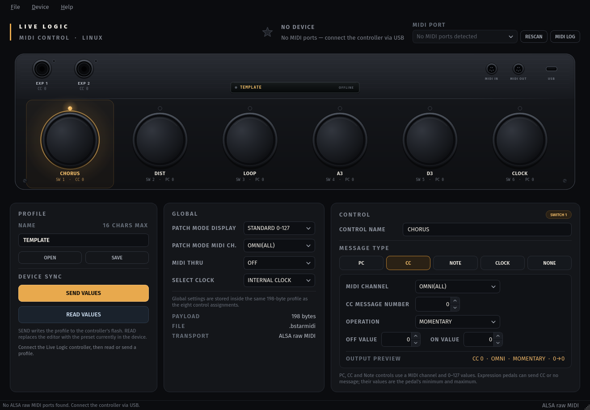

# Live Logic MIDI Control for Linux

A native Linux editor for the **Blackstar Live Logic MIDI Controller**, built from
the reverse-engineered protocol notes in
[`live-logic-midi-control-recreation.md`](live-logic-midi-control-recreation.md).

The window is laid out like the hardware: **six footswitches across the front** and
**EXP 1 / EXP 2 expression inputs at the top**. Click a control to edit its name,
message type and values, then read the current preset from the controller or send
your profile to its flash memory.



## Features

- **Device-shaped UI** with six footswitches, EXP 1/2 jacks, live control names and
  message summaries.
- **All five message types**: PC, CC, Note, Clock and None.
- Per-control MIDI channel, program/CC/note number, momentary/toggle operation,
  OFF/ON values and MIN/MAX values for expression pedals.
- **Global settings**: patch mode display, patch MIDI channel, MIDI thru and clock
  select.
- **READ VALUES** - download the controller's current preset over SysEx.
- **SEND VALUES** - upload the edited profile and commit it to device flash.
- **Open/save `.bstarmidi`** profiles using the same 198-byte hex format as the
  original application.
- **MIDI log** with every sent/received SysEx frame, useful for diagnosing the
  controller's read chunking or reporting an issue.
- Automatic detection of the `Live Logic MIDI Controller` ALSA raw-MIDI port, with
  manual port selection and rescanning as fallbacks.
- Keyboard shortcuts and a close prompt for unsaved edits.

## Requirements

- Linux with ALSA
- C++17 compiler, CMake 3.21+
- Qt 6 (Widgets)
- ALSA development headers and `pkg-config`

### Install build dependencies

Arch Linux / CachyOS:

```bash
sudo pacman -S --needed base-devel cmake qt6-base alsa-lib
```

Debian / Ubuntu:

```bash
sudo apt install build-essential cmake qt6-base-dev libasound2-dev
```

Fedora:

```bash
sudo dnf install gcc-c++ cmake qt6-qtbase-devel alsa-lib-devel
```

## Build and run

```bash
cmake -S . -B build -G Ninja -DCMAKE_BUILD_TYPE=Release
cmake --build build
./build/live-logic-control
```

If Ninja is not installed, omit `-G Ninja` (CMake will use Make).

Install locally:

```bash
cmake --install build --prefix "$HOME/.local"
```

That installs the binary, a desktop entry and a scalable icon. The desktop entry
expects `live-logic-control` to be on `PATH` (for example `~/.local/bin`).

## Using the editor

1. Connect the Live Logic to the computer with USB.
2. Start the app. A port whose name contains **Live Logic MIDI Controller** is
   detected and opened automatically. If detection fails, choose the port in the
   **MIDI PORT** dropdown and press **RESCAN**.
3. The first successful handshake reads the controller's current preset
   automatically (unless you have unsaved edits or opened a profile file first).
4. Click one of the six footswitches or **EXP 1 / EXP 2** to select it. Use the
   **MESSAGE TYPE** buttons to choose PC, CC, Note, Clock or None, then edit the
   fields below. Expression pedals can send CC or no message.
5. Press **READ VALUES** to reload the preset from the device, or **SEND VALUES** to
   upload the profile. A successful send is committed to device flash by the
   controller.
6. **SAVE** writes the profile to a `.bstarmidi` file; **OPEN** loads one. Both are
   also available from the File menu (Ctrl+S / Ctrl+O).

### Keyboard shortcuts

| Action | Shortcut |
|---|---|
| Open profile | Ctrl+O |
| Save profile | Ctrl+S |
| Save profile as | Ctrl+Shift+S |
| Read values | F5 |
| Send values | Ctrl+Enter |
| Rescan MIDI ports | Ctrl+R |
| MIDI log | Ctrl+L |
| Quit | Ctrl+Q |
| Select footswitch 1-6 | 1-6 (when the device view has focus) |
| Cycle controls | Left/Right (when the device view has focus) |

## Profile file format

`.bstarmidi` files contain only the canonical **198-byte device payload**, encoded as
lower-case hexadecimal with a space between each byte, e.g.:

```text
54 45 4d 50 4c 41 54 45 20 20 20 20 20 20 20 20 ...
```

The payload layout is documented in
[`live-logic-midi-control-recreation.md`](live-logic-midi-control-recreation.md) §7.5.
The reader accepts upper- or lower-case hex and any whitespace. The app writes the
file atomically with `QSaveFile`.

## MIDI and protocol notes

- I/O uses **ALSA raw MIDI**. The app opens the input and output streams for the
  selected duplex port, watches for device removal, and reconnects automatically.
- Device detection uses a case-insensitive match for `Live Logic MIDI Controller` in
  the ALSA port or card name. Other MIDI ports can be selected manually.
- All device communication is SysEx:
  - identity request: `F0 7E 7F 06 01 F7`
  - read preset: `F0 00 00 74 01 00 4D 43 01 00 02 00 00 F7`
  - load profile: 13-byte header + 198-byte payload + `F7`
  - save/commit: `F0 00 00 74 01 00 4D 43 01 00 05 01 00 01 F7`
- The receive side assembles complete SysEx messages from the ALSA byte stream. For
  preset reads it accepts arbitrary chunking, finds the read-response header, and
  extracts the next 198 bytes. It does not rely on the exact 48/21-byte packet split
  described as inferred in the specification.
- **Hardware-confirmed read reply** (Live Logic, observed via this app's MIDI log):
  `F0 00 00 74 01 00 4D 43 01 00 42 47 01` followed by the 198-byte payload and
  `00 F7` (213 bytes total). The actual reply uses `42 47 01` after the vendor
  prefix, not the `02 00 00` form inferred in the notes. The parser accepts both
  headers, so older/newer firmware variants are covered.
- The **MIDI LOG** window (Ctrl+L) records every TX/RX message in hex. Open it before
  pressing READ if the controller's response is not parsed; the log is the best way
  to verify or report the firmware's chunk framing.

## Troubleshooting

**No MIDI port is found**

- Confirm the controller is connected by USB and powered.
- Check ALSA sees it: `amidi -l` and `cat /proc/asound/cards`.
- Press **RESCAN**.
- Make sure your user can access `/dev/snd/*`. On most desktops this is handled by
  the login seat/ACL automatically. If not, add your user to the appropriate
  `audio` group for your distribution and log out and back in. Avoid changing
  device permissions globally.

**The MIDI port is found but cannot be opened**

Another application may be holding the raw-MIDI device. Close other editors, DAWs
or MIDI utilities and press **RESCAN**. The error message includes the ALSA reason.

**READ VALUES times out**

- The app logs the raw response in the MIDI Log. A partial response usually means
  the controller's chunk framing differs from what could be inferred statically.
- Try a second READ; the device can still be processing a previous request.
- A read timeout is reported for manual reads; automatic reads only update the
  status text so they do not interrupt startup.

**SEND VALUES does not report success**

The controller must acknowledge the profile (`0x41`) and then confirm the flash save
(`0x45`). Timeouts are reported rather than hanging the UI. If the save result is
unclear, read the preset back to verify what is on the device.

## Safety

**SEND VALUES writes to the controller's flash.** Read and save the current preset
first if you want a backup. The original specification notes that some read framing
details were inferred without hardware capture; the MIDI log exists partly so that
behavior can be verified on a real unit.

This project is not affiliated with Blackstar Amplification Ltd.

## Development

Run the protocol/model tests:

```bash
ctest --test-dir build --output-on-failure
```

The tests cover payload offsets, defaults, UTF-8 name truncation, note names, the
`.bstarmidi` encoding, command framing and several preset-read chunking variants.

Render the window headlessly to a PNG (used for the screenshot above):

```bash
QT_QPA_PLATFORM=offscreen ./build/live-logic-control \
  --screenshot /tmp/live-logic-ui.png
```

### Project layout

| Path | Purpose |
|---|---|
| `src/profile.*` | Profile model, defaults, 198-byte payload and `.bstarmidi` codec |
| `src/protocol.*` | SysEx commands, response parsing, preset accumulator |
| `src/midi.*` | ALSA raw-MIDI enumeration, reader thread and writes |
| `src/devicewidget.*` | Painted device with six footswitches and EXP jacks |
| `src/mainwindow.*` | Editor, transfer flows, file handling, MIDI log |
| `src/widgets.*` | Theme, star indicator and small UI helpers |
| `tests/test_profile.cpp` | Model/protocol tests |
| `packaging/` | Desktop entry |
| `assets/` | App icon and UI chevrons |
